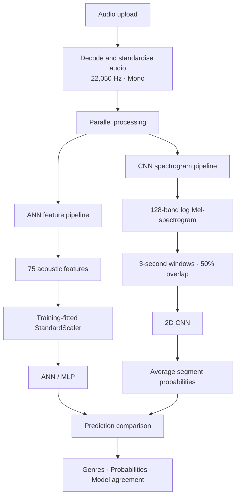

<div align="center">

# Music Genre Classification System

### Comparative Analysis of ANN and CNN Models Using the GTZAN Dataset

An audio-classification platform that compares **engineered acoustic features** with **spectrogram-based deep learning**.


</div>

---

## Overview

Music genre is expressed through several interacting properties, including rhythm, harmony, instrumentation, timbre, and production style. This project compares two neural-network approaches to classifying music:

| Model | Learning approach | Input representation |
|---|---|---|
| **ANN (MLP)** | Learns from engineered statistical acoustic descriptors | 75-dimensional feature vector |
| **CNN** | Learns local time-frequency patterns | 128-band log Mel-spectrogram segments |

Both models analyse the same uploaded recording independently. The application displays their predicted genres, probability distributions, and agreement.

> **Research focus:** Compare feature-based classification with spectrogram-based representation learning using a decontaminated, track-level GTZAN evaluation protocol.

## Project at a glance

| Dataset / system detail | Value |
|---|---:|
| Supported genres | 10 |
| Clean dataset tracks | 998 |
| Held-out test tracks | 153 |
| Neural architectures | 2 |

### Supported genres

`Blues` · `Classical` · `Country` · `Disco` · `Hiphop` · `Jazz` · `Metal` · `Pop` · `Reggae` · `Rock`

**Scope:** This is a closed-set classifier. It predicts among these ten classes; it is not a universal music-recognition system. Genres such as EDM, Folk, and Ambient are not explicit output classes.

---

## System architecture



## Model pipelines

### 1. Audio preparation

Uploaded audio is decoded as mono audio at **22,050 Hz**. The same target sample rate is used by the feature-extraction and spectrogram pipelines.

### 2. ANN — engineered acoustic features

The ANN represents each recording as a 75-dimensional feature vector.

| Feature family | Dimensions |
|---|---:|
| MFCC mean and standard deviation | 26 |
| Chroma STFT mean and standard deviation | 24 |
| Spectral Contrast mean and standard deviation | 14 |
| Spectral Centroid | 2 |
| Spectral Bandwidth | 2 |
| Spectral Rolloff | 2 |
| Zero-Crossing Rate | 2 |
| RMS Energy | 2 |
| Global Tempo | 1 |
| **Total** | **75** |

The vector is transformed using a `StandardScaler` fitted on the training partition. The ANN uses hidden layers of **256 → 128 → 64** units, with ReLU activation, batch normalisation, and dropout, followed by a 10-class softmax output.

### 3. CNN — spectrogram representation learning

The CNN learns from log Mel-spectrogram segments rather than a manually aggregated feature vector.

| Parameter | Configuration |
|---|---:|
| Sample rate | 22,050 Hz |
| Mel bands | 128 |
| FFT size | 2,048 |
| Hop length | 512 |
| Segment length | 3 seconds |
| Segment overlap | 50% |
| Input channels | 1 |

The network contains three convolutional blocks with **32, 64, and 128 filters**, followed by global average pooling and a dense classification head.

For full-track inference, the CNN predicts each overlapping segment. The segment probability vectors are averaged to obtain the track-level output.

---

## Benchmark results

### Final decontaminated GTZAN test benchmark

| Metric | ANN | CNN |
|---|---:|---:|
| **Test accuracy** | 69.28% | **80.39%** |
| **Macro F1-score** | 69.61% | **79.14%** |
| **Weighted F1-score** | 69.64% | **79.28%** |
| **Cross-entropy loss** | 0.998 | **0.881** |

On this held-out test set, the CNN records higher accuracy and F1-scores, with lower cross-entropy loss than the ANN.

### Per-genre F1-score

| Genre | Test support | ANN F1 | CNN F1 |
|---|---:|---:|---:|
| Blues | 15 | 0.643 | 0.733 |
| Classical | 15 | 0.968 | 0.966 |
| Country | 15 | 0.588 | 0.875 |
| Disco | 15 | 0.516 | 0.759 |
| Hiphop | 16 | 0.727 | 0.848 |
| Jazz | 16 | 0.882 | 0.941 |
| Metal | 16 | 0.788 | 0.867 |
| Pop | 14 | 0.714 | 0.774 |
| Reggae | 16 | 0.765 | 0.800 |
| Rock | 15 | 0.480 | 0.615 |

<details>
<summary><strong>View full precision, recall and F1-score breakdown</strong></summary>

| Genre | ANN Precision | ANN Recall | ANN F1 | CNN Precision | CNN Recall | CNN F1 |
|---|---:|---:|---:|---:|---:|---:|
| Blues | 0.692 | 0.600 | 0.643 | 0.733 | 0.733 | 0.733 |
| Classical | 0.938 | 1.000 | 0.968 | 1.000 | 0.933 | 0.966 |
| Country | 0.526 | 0.667 | 0.588 | 0.824 | 0.933 | 0.875 |
| Disco | 0.500 | 0.533 | 0.516 | 0.786 | 0.733 | 0.759 |
| Hiphop | 0.706 | 0.750 | 0.727 | 0.824 | 0.875 | 0.848 |
| Jazz | 0.833 | 0.938 | 0.882 | 0.889 | 1.000 | 0.941 |
| Metal | 0.765 | 0.812 | 0.788 | 0.929 | 0.812 | 0.867 |
| Pop | 0.714 | 0.714 | 0.714 | 0.706 | 0.857 | 0.774 |
| Reggae | 0.722 | 0.812 | 0.765 | 0.737 | 0.875 | 0.800 |
| Rock | 0.600 | 0.400 | 0.480 | 0.727 | 0.533 | 0.615 |

</details>

### Evaluation integrity

The final benchmark was designed to reduce data leakage and misleading performance estimates:

- **Duplicate handling:** Exact and near-duplicate recordings were grouped before splitting.
- **Conflicting label handling:** An identical recording appearing under both Rock and Metal labels was investigated; the Metal-labelled copy was excluded from the clean dataset.
- **Unreadable audio:** A zero-byte audio file was excluded.
- **Group-level partitioning:** Duplicate groups were kept entirely within one partition.
- **Track-level splitting:** Audio segmentation was performed after the recording-level split, preventing segments from one recording crossing partitions.

The resulting clean dataset contains **998 tracks**, with **153 tracks** in the held-out test partition.

> **How to interpret these results:** They measure performance on this decontaminated GTZAN test split. They do not guarantee performance on every commercial, contemporary, or independently produced recording.

---

## Application features

For each uploaded track, the application provides:

- ANN top prediction and confidence.
- CNN top prediction and confidence.
- Top-three genre probability distributions for both models.
- Model agreement or disagreement.
- Audio duration and confidence comparison.
- Uncertainty advisories when the probability distribution is diffuse or the leading classes are close.
- Prediction history backed by a persistent SQLite database.

### Understanding confidence

The models use softmax outputs over the ten supported genres. These are relative probabilities within the model's known classes.

A high score does **not** prove that the audio belongs to that genre. An unfamiliar or unsupported genre may still receive a confident prediction because the classifier must choose among its ten known classes. Agreement between the ANN and CNN is useful context, but it is not independent proof of correctness.

The uncertainty indicators are diagnostic heuristics; they should not be described as a fully validated unknown-genre detector.

---

## Technology stack

| Layer | Technologies |
|---|---|
| Model development | TensorFlow, Keras |
| Audio processing | Librosa |
| Data processing and evaluation | NumPy, Pandas, Scikit-learn |
| Backend API | FastAPI, Uvicorn, Pydantic |
| Database | SQLite, aiosqlite |
| Frontend | React, TypeScript, Vite |
| Styling | Tailwind CSS |
| Automated testing | Pytest |

## Repository structure

```text
NNP/
├── backend/          # FastAPI backend and API routes
├── frontend/         # React + TypeScript application
├── ml/               # Training, inference and audio-processing code
├── dataset/          # Dataset and split metadata
├── Data/             # Additional project data, if used
├── models/           # Model assets, if stored separately
├── results/          # Final metrics and evaluation visualisations
├── tests/            # Automated tests
├── requirements.txt  # Python dependencies
├── run.sh            # Startup helper
├── README.md
└── .gitignore
```

Only include folders that exist in the shared repository. Large datasets and generated temporary artefacts should not be committed unless they are required and intentionally distributed.

---

## Getting started

### Prerequisites

- Python **3.11 or 3.12**
- Node.js **18+**
- npm
- Git

### 1. Clone the repository

```bash
git clone https://github.com/d-ghosh717/Music-Genre-Classification-System.git
cd Music-Genre-Classification-System
```

### 2. Create and activate a virtual environment

**macOS / Linux**

```bash
python3.12 -m venv venv
source venv/bin/activate
```

**Windows PowerShell**

```powershell
py -3.12 -m venv venv
.\venv\Scripts\Activate.ps1
```

### 3. Install backend dependencies

```bash
pip install -r requirements.txt
```

### 4. Install frontend dependencies

```bash
cd frontend
npm install
cd ..
```

### 5. Add the GTZAN dataset (training/evaluation only)

Download the dataset from the [GTZAN dataset page on Kaggle](https://www.kaggle.com/datasets/andradaolteanu/gtzan-dataset-music-genre-classification).

Place the extracted `genres_original` directory here:

```text
dataset/genres_original/
```

If you only intend to run inference and the required trained checkpoints and preprocessing assets are included, the full training dataset may not be necessary. Follow the model-loading paths configured in the repository.

### 6. Start the backend

From the project root:

```bash
source venv/bin/activate
uvicorn backend.main:app --host 0.0.0.0 --port 8000 --reload
```

Backend API documentation: [http://localhost:8000/docs](http://localhost:8000/docs)

### 7. Start the frontend

In a second terminal:

```bash
cd frontend
npm run dev
```

Open the local URL printed by Vite, usually [http://localhost:5173](http://localhost:5173).

---

## Model training

Training is optional when the repository already contains the trained model files and preprocessing assets.

**Train the ANN**

```bash
python ml/training/train_ann.py --epochs 120 --batch-size 32
```

**Train the CNN**

```bash
python ml/training/train_cnn.py --epochs 30 --batch-size 64
```

Before running training, verify the current script arguments, dataset split configuration, and output paths. Preserve the final benchmark checkpoints when conducting new experiments; save new experiment outputs separately.

## API reference

| Method | Endpoint | Description |
|---|---|---|
| `GET` | `/api/health` | Backend and service health |
| `GET` | `/api/dataset/status` | Dataset status |
| `GET` | `/api/models/status` | ANN and CNN loading status |
| `POST` | `/api/predict` | Upload audio and receive predictions |
| `GET` | `/api/evaluation` | Test-set evaluation metrics |
| `GET` | `/api/visualizations/{model}/{file}` | Retrieve evaluation visualisations |
| `GET` | `/api/history` | List prediction history |
| `GET` | `/api/history/{id}` | Retrieve a prediction record |
| `DELETE` | `/api/history/{id}` | Delete a prediction record |

## Run tests

From the project root:

```bash
pytest tests/ -v
```

---

## Limitations and future work

- **Fixed taxonomy:** Only the ten GTZAN genres are represented in the classifier.
- **Genre overlap:** Related genres share acoustic characteristics, which can lead to confusion.
- **Domain shift:** Commercial mastering, modern production, recording quality, and independent production styles may differ from GTZAN.
- **Confidence calibration:** Softmax confidence is not the same as real-world correctness.
- **Unknown-genre recognition:** Reliable out-of-distribution detection requires a separate method and independent evaluation.
- **External validation:** Broader claims require a larger, provenance-documented collection of genuine recordings with reliable labels and artist-level separation.

## Acknowledgements

This project uses the GTZAN music genre dataset for model development and evaluation. Please follow the dataset source's terms and attribution requirements.

---

<div align="center">

**Music Genre Classification System**  
*Comparative Neural Network Analysis · ANN vs CNN*

</div>
